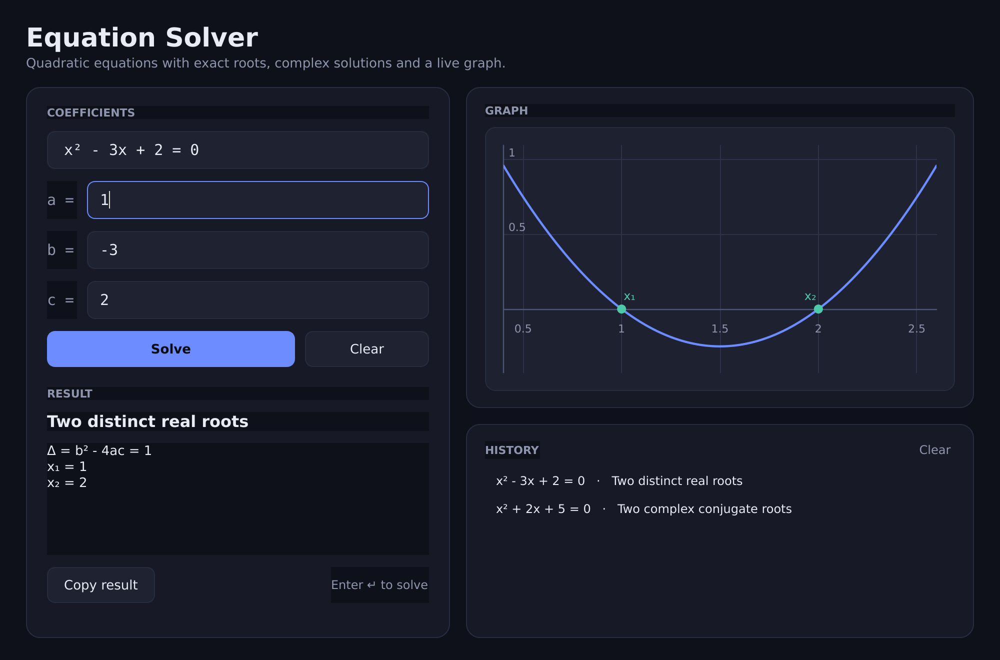

# Equation Solver

A small desktop app for solving quadratic equations `ax² + bx + c = 0` with exact
roots, complex solutions and a live graph. Built with **PySide6**.



## Features

- **Every case is handled**: two distinct real roots, one double root, complex
  conjugate roots (the original Tkinter version reported "no solution" whenever
  Δ < 0), and the linear branch when `a = 0`.
- **Exact arithmetic**: coefficients are parsed into `Fraction`, so `1/3` stays
  `1/3` instead of `0.333…`, and rational roots are printed exactly.
- **Exact radical forms** for irrational roots, e.g. `x² + x - 1 = 0` →
  `x = (-1 ± √5) / 2`, alongside 6-decimal approximations.
- **Robust root formula**: the numerically stable `q = -(b + sign(b)√Δ) / 2`
  form is used, so large coefficients do not lose the small root
  (`10¹⁸x² - 10¹⁸x + 1 = 0` gives `1e-18` and `1`, not `0` and `1`).
- **Flexible input**: integers, decimals (`1.5` or `1,5`), fractions (`1/2`) and
  scientific notation (`2e3`); an empty field counts as `0`.
- **Graph** of the curve with its grid, axes, vertex and root markers, drawn with
  `QPainter` (no extra Qt modules needed).
- Live equation preview, discriminant display, inline validation, copyable
  result, and a clickable history of previous equations.

## Requirements

- Python 3.10 or newer
- PySide6 6.6 or newer (`pip install -r requirements.txt`)

Developed and tested on Python 3.14 with PySide6 6.12 on Linux.

## Run

```bash
python -m venv .venv
.venv/bin/pip install -r requirements.txt     # Windows: .venv\Scripts\pip
.venv/bin/python main.py                      # Windows: .venv\Scripts\python main.py
```

### Keyboard shortcuts

| Shortcut | Action |
| --- | --- |
| `Enter` | Solve |
| `Ctrl+L` | Clear the coefficients |
| `Ctrl+Shift+C` | Copy the result to the clipboard |

## Tests

The maths layer is plain Python; the UI tests drive a real `QMainWindow` through
Qt's `offscreen` platform, so no display is required.

```bash
python -m unittest discover -s tests -t . -v
```

| File | Covers |
| --- | --- |
| `tests/test_solver.py` | Parsing, discriminant, every root case, formatting, large numbers |
| `tests/test_ui.py` | Inputs, results, errors, history, clipboard, shortcuts, plot rendering |

The same command runs in CI (`.github/workflows/tests.yml`) on every push and
pull request.

## Project layout

| File | Purpose |
| --- | --- |
| `main.py` | `MainWindow`: inputs, result panel, history, shortcuts |
| `solver.py` | Pure maths: parsing, discriminant, roots, formatting (no Qt) |
| `plot_widget.py` | `QPainter` graph widget: grid, axes, curve, root markers |
| `theme.py` | Palette and stylesheet shared by the window and the painter |
| `assets/` | Window icon and the screenshot used above |

## Standalone executable

```bash
pip install pyinstaller
pyinstaller --noconsole --name EquationSolver --icon assets/calculator.ico main.py
```

The result appears in `dist/EquationSolver/` (Linux and Windows). The build is not
automated here; `build/` and `dist/` are ignored by git.

## Background

This is a PySide6 rewrite of `Polynome`, an earlier Tkinter version of the same
app. Beyond the toolkit change, it fixes the missing complex-root case, the
integer-only input, the fixed-size result box and the modal error dialog that
wiped the entered coefficients.